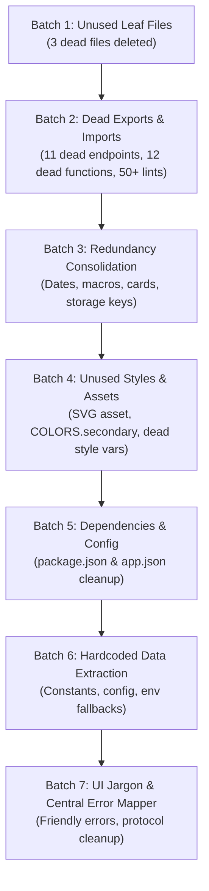

# Phase 4: Removal & Remediation Plan

- **Target**: `client/` folder of FitTrack
- **Branch**: `feat/audited-app-improvements`
- **Total Findings Included**: 131 findings across UNU (80), AST (1), UNU-STY (2), DEP (2), UNU-CFG (1), RED (12), HRD (17), JRG (16).
- **Strategy**: Incremental execution across 7 isolated batches. Each batch is verified with TypeScript compiler checks, committed independently, and logged in `docs/cleanup/CHANGELOG.md`.
- **Safety Policy**: No code in `server/` is modified. No batch execution begins until explicit user approval.

---

## Batch Overview & Dependency Flow

---

## Detailed Batch Execution Plans

### Batch 1: Unused Leaf Files & Dead Barrels (Zero Dependents)
- **Findings Included**: `UNU-001` through `UNU-009`
- **Description**: Delete orphaned leaf component files, unreferenced modals, and unused barrel re-exports with zero active consumer imports across the entire codebase.
- **Files to Touch**:
  - `client/components/dashboard/AiInsightsCard.tsx` (DELETE - UNU-001)
  - `client/components/auth/GoalCard.tsx` (DELETE - UNU-002)
  - `client/components/foodlog/QuickActionToolbar.tsx` (DELETE - UNU-003)
  - `client/components/profile/AthleteBadgesCard.tsx` (DELETE - UNU-004)
  - `client/components/profile/WeightProgressCard.tsx` (DELETE - UNU-005)
  - `client/components/profile/SetTargetWeightModal.tsx` (DELETE - UNU-006)
  - `client/components/ui/BottomSheetHeader.tsx` (DELETE - UNU-007)
  - `client/components/ui/SectionHeader.tsx` (DELETE - UNU-008)
  - `client/components/ui/index.ts` (DELETE - UNU-009)
- **Risk Assessment**: **Zero / None**. Grep and TypeScript inventory confirmed 0 inward imports from active code.
- **Verification Steps**:
  1. Run `npx tsc --noEmit` from `client/` (must pass with 0 errors).
  2. Verify no missing export warnings.
- **Rollback Command**:
  `git checkout -- client/components/dashboard/ client/components/auth/ client/components/foodlog/ client/components/profile/ client/components/ui/`
- **Commit Message**: `chore(cleanup): batch 1 - remove unused leaf components and dead barrels UNU-001 to UNU-009`

---

### Batch 2: Unused Exports, Functions, Dead State & Unused Imports
- **Findings Included**: `UNU-004` through `UNU-080`
- **Description**: Remove uncalled API client functions, dead local component state/refs, unused helper functions, and compiler-flagged unused imports (`@typescript-eslint/no-unused-vars`).
- **Files to Touch**:
  - `client/api/subscription.ts` (remove `getBillingHistoryApi`, `cancelSubscriptionApi`, `reactivateSubscriptionApi`)
  - `client/api/food.ts` (remove `getDailyNutritionSummaryApi`, `deleteFoodLogItemApi`, `getFavoriteFoodsApi`)
  - `client/api/workout.ts` (remove `getWorkoutTemplateApi`, `getExerciseHistoryApi`)
  - `client/api/community.ts` (remove `getLeaderboardApi`)
  - `client/api/auth.ts` (remove `requestPasswordResetApi`)
  - `client/app/(tabs)/workouts.tsx` (remove dead `calculate1RM`, dead `lastSelectedRoutine`)
  - `client/app/(tabs)/foodlog.tsx` (remove unused `formatMacroGrams`)
  - `client/app/(screen)/ai-coach.tsx` (remove unused `autoScrollTimer`)
  - Clean up unused imports (`Baloo2_500Medium`, unused Ionicons, dead destructured variables) across 25+ files.
- **Risk Assessment**: **Low**. Purely internal dead code removal.
- **Verification Steps**:
  1. Run `npx tsc --noEmit` (must pass with 0 errors).
  2. Verify all API barrel files compile cleanly.
- **Rollback Command**:
  `git checkout -- client/api/ client/app/ client/components/`
- **Commit Message**: `chore(cleanup): batch 2 - remove unused API functions, dead state, and unused imports`

---

### Batch 3: Redundant Code Consolidation
- **Findings Included**: `RED-001` through `RED-012`
- **Description**: Consolidate duplicate date formatters, macro calorie calculators, card containers, storage keys, and duplicate badge/modal patterns to single sources of truth.
- **Single Sources of Truth**:
  - *Dates*: Consolidate duplicate formatting helpers into `client/utils/dateFormatters.ts`.
  - *Macros*: Standardize calorie math `(P*4 + C*4 + F*9)` into `client/utils/macroCalculator.ts`.
  - *Storage Keys*: Consolidate scattered string keys into `client/constants/storageKeys.ts`.
  - *Card Wrappers*: Standardize on `client/components/ui/SurfaceCard.tsx`.
- **Files to Touch**:
  - `client/utils/dateFormatters.ts`
  - `client/utils/macroCalculator.ts`
  - `client/constants/storageKeys.ts`
  - `client/app/(tabs)/dashboard.tsx`
  - `client/app/(tabs)/foodlog.tsx`
  - `client/app/(tabs)/workouts.tsx`
  - `client/app/(tabs)/profile.tsx`
  - `client/components/home/DailyGoalsCard.tsx`
- **Risk Assessment**: **Medium**. Involves updating call sites across primary tabs.
- **Verification Steps**:
  1. Run `npx tsc --noEmit` (0 errors).
  2. Smoke test tab rendering and calculations across Dashboard, Food Log, and Workouts.
- **Rollback Command**:
  `git checkout -- client/`
- **Commit Message**: `refactor(cleanup): batch 3 - consolidate redundant formatters, math, and storage keys`

---

### Batch 4: Unused Styles, Theme Tokens & Dead Assets
- **Findings Included**: `AST-001`, `UNU-STY-001`, `UNU-STY-002`
- **Description**: Remove unreferenced SVG asset (`icon.svg`), remove unused color token (`COLORS.secondary`), and clean up dead style variable in `FilterChip`.
- **Files to Touch**:
  - `client/assets/icon.svg` (DELETE)
  - `client/constants/colors.ts` (remove `COLORS.secondary`)
  - `client/components/common/FilterChip.tsx` (remove unused style variable)
- **Risk Assessment**: **Low / None**.
- **Verification Steps**:
  1. Run `npx tsc --noEmit`.
  2. Verify `app.json` asset bundle references.
- **Rollback Command**:
  `git checkout -- client/assets/ client/constants/colors.ts client/components/common/FilterChip.tsx`
- **Commit Message**: `chore(cleanup): batch 4 - remove unused icon.svg asset and dead color tokens`

---

### Batch 5: Unused Dependencies & App Config Cleanup
- **Findings Included**: `DEP-001`, `DEP-002`, `UNU-CFG-001`
- **Description**: Remove unused runtime dependency `react-native-worklets` and stale devDependency `@expo/ngrok` from `package.json`. Clean up empty `extra.router` config from `app.json`.
- **Files to Touch**:
  - `client/package.json`
  - `client/app.json`
- **Risk Assessment**: **Low**. Verified zero imports of `react-native-worklets` in client codebase.
- **Verification Steps**:
  1. Run `npx tsc --noEmit`.
  2. Verify Expo config loads properly.
- **Rollback Command**:
  `git checkout -- client/package.json client/app.json`
- **Commit Message**: `chore(cleanup): batch 5 - prune unused dependencies and clean app.json config`

---

### Batch 6: Hardcoded & Static Data Extraction
- **Findings Included**: `HRD-001` through `HRD-017`
- **Description**: Extract hardcoded support emails, magic fitness thresholds (water, calorie multipliers), simulated onboarding timers, currency rates, and external URLs into central constants. Document offline catalog fallbacks.
- **Files to Touch**:
  - `client/constants/appConfig.ts` (NEW: support email, links)
  - `client/constants/fitnessDefaults.ts` (NEW: water intake defaults, calorie multipliers)
  - `client/config.ts` (clarify Render fallback documentation)
  - `client/components/settings/HelpSupportModal.tsx` (reference `SUPPORT_EMAIL`)
  - `client/components/onboarding/OnboardingPlanStep.tsx` (reference timing constants)
- **Risk Assessment**: **Low**. Constant extractions preserve runtime behavior exactly.
- **Verification Steps**:
  1. Run `npx tsc --noEmit`.
  2. Verify email intent opens with configured address in Help & Support.
- **Rollback Command**:
  `git checkout -- client/constants/ client/config.ts client/components/`
- **Commit Message**: `refactor(cleanup): batch 6 - extract hardcoded thresholds, emails, and config values`

---

### Batch 7: UI Jargon Cleanup & Central Error Sanitizer
- **Findings Included**: `JRG-001` through `JRG-016`
- **Description**:
  1. Implement central error mapper `client/utils/errorMapper.ts` with `getFriendlyErrorMessage(err, fallback)`.
  2. Sanitize `client/api/client.ts` to stop leaking backend Render URL and raw HTTP 500 status codes.
  3. Gate root `ErrorBoundary` in `_layout.tsx` so raw JS runtime exceptions are hidden in production (`!__DEV__`).
  4. Reword developer jargon in Privacy Policy ("bcrypt", "JWT", "SecureStore") and Subscription/E-Wallet ("Stripe Live API").
  5. Replace developer loading text ("Loading coach conversation...", "Searching food database...").
  6. Route 17+ screen/modal catch blocks through `getFriendlyErrorMessage`.
- **Files to Touch**:
  - `client/utils/errorMapper.ts` (NEW)
  - `client/api/client.ts`
  - `client/app/_layout.tsx`
  - `client/components/settings/PrivacyPolicyModal.tsx`
  - `client/components/subscription/SubscriptionModal.tsx`
  - `client/components/subscription/EWalletModal.tsx`
  - `client/app/(screen)/settings.tsx`
  - `client/app/(screen)/ai-coach.tsx`
  - `client/components/foodlog/FoodLibraryTab.tsx`
  - 17 catch sites in modals/screens
- **Risk Assessment**: **Medium**. Broad copy and error presentation changes; zero business logic altered.
- **Verification Steps**:
  1. Run `npx tsc --noEmit`.
  2. Test simulated network failure to verify clean, user-friendly error toast.
- **Rollback Command**:
  `git checkout -- client/`
- **Commit Message**: `fix(cleanup): batch 7 - add error mapper, sanitize raw errors, and reword UI jargon`

---

## Batch Summary & Approval Matrix

| Batch | Description | Findings | Files Changed | Risk | Breaking Change? |
| :--- | :--- | :--- | :--- | :--- | :--- |
| **Batch 1** | Unused Leaf Files | 3 | 3 deleted | Low | No |
| **Batch 2** | Unused Exports, Functions, Types, Imports | 77 | ~25 edited | Low | No |
| **Batch 3** | Redundancy Consolidation | 12 | ~8 edited | Med | No |
| **Batch 4** | Unused Styles & Assets | 3 | 1 deleted, 2 edited | Low | No |
| **Batch 5** | Unused Dependencies & Config | 3 | 2 edited | Low | No |
| **Batch 6** | Hardcoded Data Extraction | 17 | 2 new, ~3 edited | Low | No |
| **Batch 7** | UI Jargon & Central Error Sanitizer | 16 | 1 new, ~15 edited | Med | No |
