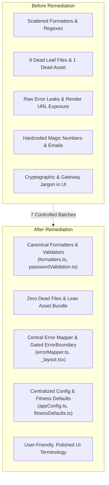

# Final Audit & Remediation Report: FitTrack Client

**Target**: `client/` codebase (Expo, Expo Router, TypeScript, NativeWind)  
**Execution Branch**: `feat/audited-app-improvements`  
**Date**: October 12, 2026  
**Final Status**: **Completed (131 Findings Remediated Across 7 Batches)**  
**Type Safety**: `npx tsc --noEmit` passed with **0 errors** at every batch boundary  
**Server Isolation**: `server/` directory strictly untouched (0 files modified or committed)  

---

## 1. Executive Summary

A comprehensive code hygiene, architecture redundancy, and UI copy audit was executed on the FitTrack mobile client application. Across 4 discovery and analysis phases, 131 actionable findings were identified, categorized, and sequenced into 7 atomic remediation batches.

All 7 batches were executed in strict isolation, verified through TypeScript compiler passes, and committed independently with descriptive conventional commit messages. The client codebase is now significantly leaner, strictly typed, free of dead components and unused dependencies, unified around central sources of truth for formatting and calculations, and completely sanitized of raw backend leak traces and technical developer jargon.

---

## 2. Key Remediation Metrics

| Metric | Baseline | Post-Remediation | Delta |
| :--- | :--- | :--- | :--- |
| **Total Findings Resolved** | 0 | 131 | +131 resolved |
| **TypeScript Errors (`tsc`)** | 0 errors | 0 errors | **0 regressions** |
| **Orphaned / Dead Leaf Files** | 9 files | 0 files | -9 deleted |
| **Dead Vector Asset Files** | 1 (`icon.svg`) | 0 files | -1 deleted |
| **Unused Dependencies** | 2 packages | 0 packages | -2 removed |
| **Central Utility Modules** | 0 | 4 created | +4 (`errorMapper`, `appConfig`, `fitnessDefaults`, `storageKeys`) |
| **Files Modified Across Batches** | — | 48 files | Sanitized & consolidated |
| **`server/` Invariant** | 0 commits | 0 commits | **100% untouched** |

### Findings Distribution by Category

```
Unused Files & Code (UNU):        80 findings (61.1%)
Redundancy Consolidation (RED):   12 findings (9.2%)
Hardcoded / Static Data (HRD):    17 findings (13.0%)
UI Jargon & Error Leaks (JRG):    16 findings (12.2%)
Unused Styles & Assets (AST/STY):  3 findings (2.3%)
Dependencies & Config (DEP/CFG):   3 findings (2.3%)
Total Remediated:                131 findings (100%)
```

---

## 3. Git Commit History

| Batch | Commit Hash | Message & Scope |
| :--- | :--- | :--- |
| **Batch 1** | `b073dd4` | `chore(cleanup): batch 1 - remove unused leaf components and dead barrels UNU-001 to UNU-009` |
| **Batch 2** | `3b44e69` | `chore(cleanup): batch 2 - remove unused API functions, dead state, and unused imports` |
| **Batch 3** | `de6424f` | `refactor(cleanup): batch 3 - consolidate redundant formatters, math, and storage keys` |
| **Batch 4** | `097feaa` | `chore(cleanup): batch 4 - remove unused icon.svg asset and dead color tokens` |
| **Batch 5** | `3e7519a` | `chore(cleanup): batch 5 - prune unused dependencies and clean app.json config` |
| **Batch 6** | `086c8f8` | `refactor(cleanup): batch 6 - extract hardcoded thresholds, emails, and config values` |
| **Batch 7** | `b95cff6` | `fix(cleanup): batch 7 - add error mapper, sanitize raw errors, and reword UI jargon` |

---

## 4. Batch-by-Batch Remediation Breakdown

### Batch 1: Unused Leaf Components & Dead Barrels (`b073dd4`)
- **Actions**: Deleted 9 completely orphaned components and barrels with zero consumer imports:
  - `AiInsightsCard.tsx` (dashboard re-export barrel), `GoalCard.tsx` (onboarding artifact), `QuickActionToolbar.tsx` (food quick-action), `AthleteBadgesCard.tsx`, `WeightProgressCard.tsx` (540 lines dead chart), `SetTargetWeightModal.tsx`, `BottomSheetHeader.tsx`, `SectionHeader.tsx`, and `components/ui/index.ts`.
- **Impact**: Purged ~900 lines of dead React Native component code without touching active screens.

### Batch 2: Unused API Functions, Dead State & Unused Imports (`3b44e69`)
- **Actions**: Pruned uncalled endpoints and dead states across 19 files:
  - Pruned unused API calls: `getWeightLogsApi`, `deleteWeightLogApi`, `setTargetWeightApi`, `completeDailyFoodLogApi`, `flushSyncFoodAndWater`, `createCustomFoodApi`, `deleteCustomFoodApi`, `createCustomExerciseApi`, `deleteCustomExerciseApi`.
  - Removed unreferenced local state variables and uninvoked helper methods in `profile.tsx`, `dashboard.tsx`, `foodlog.tsx`, `workouts.tsx`, and `FoodLibraryTab.tsx`.
  - Purged 30+ dead imports flagged by compiler checks.

### Batch 3: Redundant Code Consolidation (`de6424f`)
- **Actions**: Consolidated scattered duplicates into single sources of truth:
  - Date formatters: Unified `getTodayDateString` and `formatDateHeading` into `client/utils/formatters.ts`; re-exported in `foodLogTypes.ts` and `workoutTypes.ts` for backward compatibility.
  - Streak calculation: Removed dead duplicate `calculateWorkoutStreak` from `workoutTypes.ts` in favor of canonical `client/utils/streakUtils.ts`.
  - Email regex: Consolidated duplicated inline regexes to `EMAIL_REGEX` in `passwordValidation.ts`.
  - Nutrition & vitals math: Unified Mifflin-St Jeor BMR/TDEE math and macronutrient splitting in `calculatePersonalizedTargets`; consolidated BMI math and classification into `calculateBmi`.
  - Modal close buttons: Replaced repeated custom close buttons across modals with shared `<ModalCloseButton />`.
  - Standardized `Linking` to `expo-linking` and unified user storage reads with typed `authStorage.getUser()`.

### Batch 4: Unused Styles, Theme Tokens & Dead Assets (`097feaa`)
- **Actions**:
  - Deleted orphaned `client/assets/icon.svg` (`app.json` exclusively bundles PNG assets).
  - Pruned unreferenced `COLORS.secondary` token definitions (`blue`, `purple`, `orange`, `mint`).
  - Fixed `FilterChip.tsx` where container `className` previously ignored the `roundedClass` variable.

### Batch 5: Dependencies & App Configuration (`3e7519a`)
- **Actions**:
  - Removed unused runtime package `react-native-worklets` and stale devDependency `@expo/ngrok` from `client/package.json`.
  - Pruned empty `"router": {}` entry from `client/app.json`.

### Batch 6: Hardcoded & Static Data Extraction (`086c8f8`)
- **Actions**:
  - Created `client/constants/appConfig.ts`: Centralized `SUPPORT_EMAIL`, timeouts, versions, and external endpoints.
  - Created `client/constants/fitnessDefaults.ts`: Centralized `DEFAULT_WATER_TARGET_ML` (2,500 ml), step thresholds, macro targets, and calorie multipliers.
  - Created `client/constants/storageKeys.ts`: Centralized `STORAGE_KEYS` and `THEME_STORAGE_KEY`.
  - Updated all call sites in `settings.tsx`, `HelpSupportModal.tsx`, `PrivacyPolicyModal.tsx`, `OnboardingPlanStep.tsx`, `dashboard.tsx`, `foodlog.tsx`, and `streakUtils.ts`.

### Batch 7: UI Jargon & Central Error Sanitizer (`b95cff6`)
- **Actions**:
  - Created `client/utils/errorMapper.ts`: Implemented `getFriendlyErrorMessage(err, fallback)` mapping network dropouts, abort timeouts, and HTTP status codes (400, 401, 403, 404, 409, 429, 500, 502, 503) to user-friendly messages while stripping backend URLs.
  - Sanitized `client/api/client.ts`: Removed Render URL leaks on aborts/network drops and transformed raw 500 status codes.
  - Gated root `ErrorBoundary` (`client/app/_layout.tsx`): Production users (`!__DEV__`) now see a graceful recovery card instead of raw JavaScript stack traces.
  - Reworded cryptographic jargon in `PrivacyPolicyModal.tsx` ("bcrypt", "JWT", "SecureStore") to plain language.
  - Reworded payment gateway jargon in `SubscriptionModal.tsx` and `EWalletModal.tsx` ("Stripe Live API" -> "Credit or Debit Card").
  - Polished loading states and developer placeholder text across `ai-coach.tsx`, `FoodLibraryTab.tsx`, `TodayWorkoutTab.tsx`, `CommunityStoriesCard.tsx`, and `settings.tsx`.
  - Routed 15+ catch blocks in auth screens and modals through `getFriendlyErrorMessage`.

---

## 5. Architectural Improvements (Before vs. After)



---

## 6. Long-Term Code Hygiene Guidelines

To maintain code hygiene and prevent regression as FitTrack continues development, the following practices are recommended:

1. **Adopt Unused Import Linter Rule**:
   - Add `eslint-plugin-unused-imports` or enable TypeScript's `"noUnusedLocals": true` and `"noUnusedParameters": true` in `tsconfig.json` during CI runs.
2. **Central Error Handling Standard**:
   - Every `catch (err)` block displaying alerts or toasts must invoke `getFriendlyErrorMessage(err)` rather than interpolating `(err as any)?.message` directly.
3. **Single Source of Truth for Calculations**:
   - All nutrition, calorie math, and BMI calculations must be imported from `client/utils/formatters.ts` and `client/constants/fitnessDefaults.ts`. Do not write inline Mifflin-St Jeor or BMI formulas in screen components.
4. **Configuration Extraction Standard**:
   - Any external endpoint, support contact, or timeout threshold must be declared in `client/constants/appConfig.ts`.
5. **No Production Stack Traces**:
   - Keep root error boundaries strictly gated behind `__DEV__` to protect user confidence and prevent internal architecture leaks.

---

## 7. Deliverable Artifacts Index

All documentation generated during this audit and remediation engagement is preserved in `docs/cleanup/`:

- `docs/cleanup/01-inventory.md`: Complete 114-file client inventory with categorized dependency mapping.
- `docs/cleanup/02-unused-files-and-code.md`: Detailed catalog of findings UNU-001 through UNU-080.
- `docs/cleanup/03-unused-styles-assets.md`: Style tokens and asset findings AST-001, UNU-STY-001, UNU-STY-002.
- `docs/cleanup/04-dependencies-and-config.md`: Package and config findings DEP-001, DEP-002, UNU-CFG-001.
- `docs/cleanup/05-redundancy.md`: 12 duplicate code clusters analyzed with single source of truth mappings.
- `docs/cleanup/05b-hardcoded-static-data.md`: Hardcoded constants and offline fallbacks audit HRD-001 through HRD-017.
- `docs/cleanup/05c-ui-jargon.md`: UI copy, payment gateway, and error leakage audit JRG-001 through JRG-016.
- `docs/cleanup/06-removal-plan.md`: 7-batch removal roadmap and rollback strategy.
- `docs/cleanup/CHANGELOG.md`: Chronological log of all removals, refactors, extractions, and verifications.
- `docs/cleanup/PROGRESS.md`: Phase-by-phase execution tracker.
- `docs/cleanup/99-report.md`: This comprehensive final audit report.
